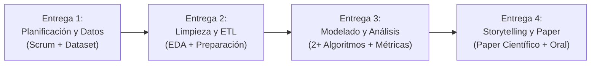

# GUÍA DEL TRABAJO PRÁCTICO INTEGRAL – PROYECTO DE CIENCIA DE DATOS
**Cátedra:** Ciencia de Datos – UTN FRC (Curso 5K1)  
**Modalidad:** Grupal  
**Formato de Entrega Final:** Paper Científico (plantilla provista por la cátedra) + Presentaciones Orales/Presenciales  
**Objetivo General:** Aplicar el ciclo de vida completo de un proyecto de Ciencia de Datos, desde la planificación y adquisición de datos hasta el modelado, análisis y comunicación de resultados (Data Storytelling).

---

## 1. Requisitos Clave y Condiciones de Borde del Dataset
- **Tamaño Mínimo del Dataset:** Al menos **20.000 filas**.
- **Origen de los Datos:** Definido y validado con el equipo docente. Puede implicar la unificación de diversas fuentes abiertas (portales como datos.gob.ar, World Bank, Kaggle, repositorios gubernamentales, etc.).
- **Relevancia del Problema:** Debe permitir extraer conocimiento oculto y significativo, proponer soluciones a problemáticas reales e identificar patrones y tendencias.

---

## 2. Desglose Estructurado de las 4 Entregas

### Entrega 1: Planificación y Obtención de Datos
- **Objetivo:** Definir el alcance, gobernanza ágil y dataset de trabajo.
- **Entregables Requeridos:**
  1. Diseño del plan de proyecto bajo metodología ágil **Scrum** (roles, sprints preliminares, backlog inicial).
  2. Selección y justificación del dataset ($\ge 20.000$ filas).
  3. Documentación del origen, contexto y posibles **insights** u objetivos analíticos a responder.
  4. Hipótesis iniciales y justificación formal de la selección.

---

### Entrega 2: Limpieza y Preparación de Datos (ETL)
- **Objetivo:** Construir un pipeline reproducible y generar el dataset limpio y listo para modelado.
- **Entregables Requeridos:**
  1. **Análisis Exploratorio de Datos (AED/EDA):** Análisis visual y estadístico inicial (distribuciones, correlaciones, boxplots).
  2. **Auditoría de Calidad:** Detección de inconsistencias en base a las dimensiones de calidad de datos.
  3. **Tratamiento de Anomalías:**
     - Estrategia de valores nulos (eliminación vs imputación por media, mediana o moda, debidamente justificada).
     - Detección y tratamiento de outliers (mediante IQR / boxplots).
  4. **Transformación:** Integración de fuentes, codificación categórica (One-Hot Encoding u Ordinal), escalado si corresponde.
  5. **Justificación Metodológica:** Explicar el "por qué" de cada decisión técnica tomada sobre el dataset.

---

### Entrega 3: Modelado y Análisis de Resultados
- **Objetivo:** Aplicar algoritmos de Machine Learning, optimizar parámetros y evaluar desempeño rigurosamente.
- **Entregables Requeridos:**
  1. **Selección de Modelos:** Aplicar **al menos 2 algoritmos** de Machine Learning (ejemplos: Regresión Logística, Random Forest, AdaBoost, K-Means, etc.).
  2. **Ajuste y Justificación de Parámetros:** Explicar el rol de cada hiperparámetro ajustado y justificar su selección (no usar cajas negras sin criterio).
  3. **Tratamiento del Balanceo de Clases:** Si las clases están desbalanceadas, aplicar técnicas vistas (pesos de clase, SMOTE, submuestreo) y reportar su impacto.
  4. **Evaluación Rigurosa con Métricas Apropiadas:**
     - En clasificación: Matriz de Confusión, Accuracy, Precision, Recall, F1-Score (macro y weighted average), Curvas ROC y AUC.
     - En clustering: Inercia (método del codo) y Coeficiente de Silueta.
  5. **Interpretación del Conocimiento:** Traducir los números y métricas en conclusiones reales respecto al problema original de negocio/dominio.

---

### Entrega 4: Presentación Final y Data Storytelling
- **Objetivo:** Comunicar el valor, los hallazgos y las decisiones técnicas de manera clara, persuasiva e impactante.
- **Entregables Requeridos:**
  1. **Paper Científico Completo:** Redactado rigurosamente utilizando la **plantilla de paper provista por la cátedra**.
  2. **Presentación Oral tipo Data Storytelling:**
     - Planteo del problema y objetivo.
     - Dataset y pipeline metodológico utilizado.
     - Principales hallazgos y decisiones técnicas críticas justificadas.
     - Conclusiones y recomendaciones accionables.
     - Aplicar los principios de visualización efectiva (evitar sobrecarga, evitar gráficos erróneos o "muerte por PowerPoint").

---

## 3. Criterios de Evaluación de la Cátedra (Rúbrica)
1. **Claridad Conceptual y Dominio Técnico:** Manejo riguroso de la terminología de ciencia de datos.
2. **Coherencia Integral:** Alineación estricta entre el problema definido, la naturaleza de los datos y los modelos seleccionados.
3. **Justificación de Decisiones:** Cada filtro, imputación, algoritmo e hiperparámetro debe estar fundado técnica y estadísticamente.
4. **Expresión Oral y Storytelling:** Capacidad de sintetizar y transmitir insights con convicción y creatividad.
5. **Trabajo en Equipo y Organización:** Participación activa y coordinada de todos los integrantes durante las presentaciones orales de cada hito.
6. **Cumplimiento de Plazos y Formato.**

---

## 4. Checklist de Validación que el Agente Debe Exigir al Desarrollar Código

- [ ] ¿El dataset tiene al menos 20.000 filas y se conoce su procedencia?
- [ ] ¿Se inspeccionaron y documentaron los nulos, outliers y distribuciones con boxplots / describe()?
- [ ] ¿Se justificó cada imputación de nulos (media/mediana/moda) y tratamiento de outliers?
- [ ] ¿Se codificaron adecuadamente las variables categóricas (OneHot con `drop_first` o Label Encoding ordenado)?
- [ ] ¿Se probaron al menos 2 modelos de Machine Learning distintos?
- [ ] Si hay desbalance de clases, ¿se evaluó algo más allá del simple Accuracy (ej. Recall, F1, AUC-ROC)?
- [ ] ¿Se guardaron los gráficos y tablas en formatos listos para exportar al paper científico?
